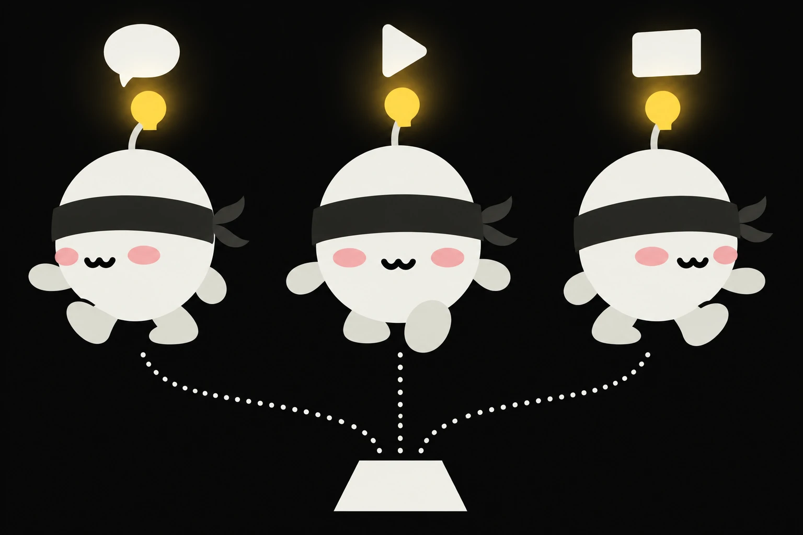
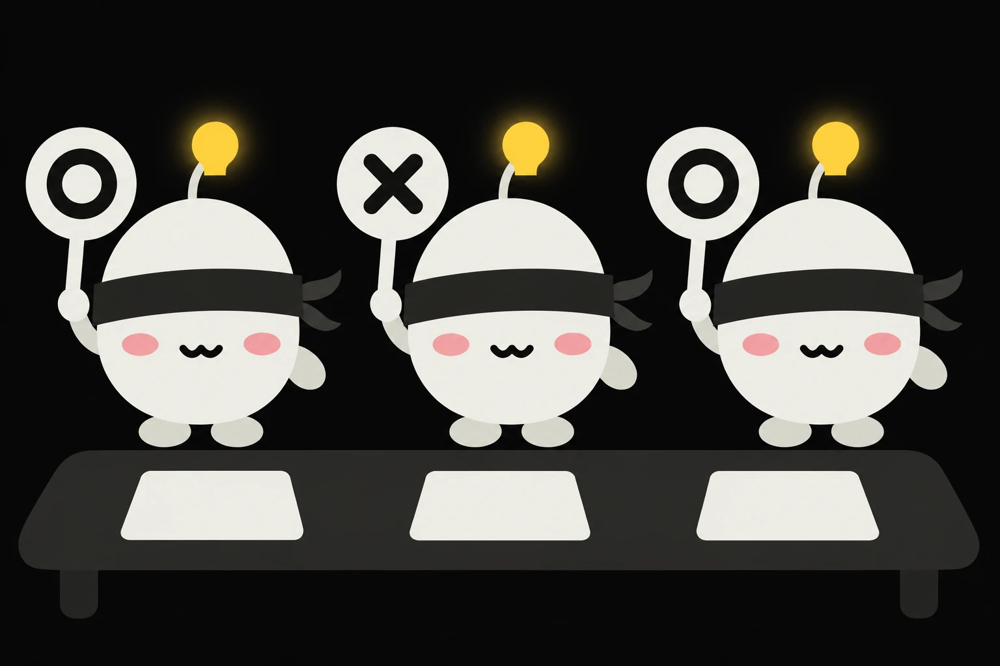
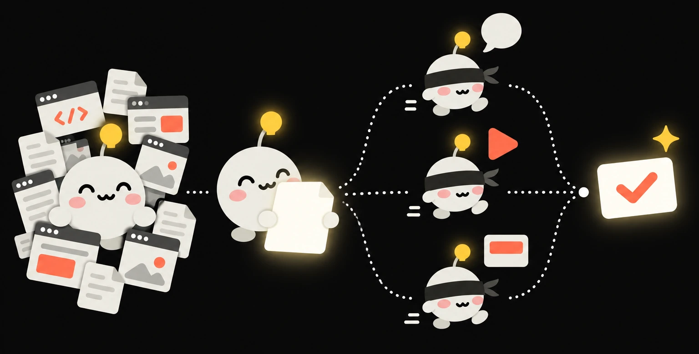

<div align="center">
  

  <h1>Blindfold</h1>

  <p><strong>Cuanto más sabe, menos imagina.</strong></p>
  <p>Un Agent Skill que oculta lo que tu agente ya sabe,<br>para que subagentes nuevos piensen desde cero.</p>

  <p>
    <a href="https://agentskills.io"></a>
    
    
    
    <a href="LICENSE"></a>
  </p>

  <p><a href="README.md">English</a> · <a href="README.ko.md">한국어</a> · <a href="README.zh-CN.md">简体中文</a> · <a href="README.ja.md">日本語</a> · <strong>Español</strong></p>
</div>

---

## Por qué

Un agente que ya leyó tus pantallas, tu código y la conversación se ancla en ellos. Pídele una dirección nueva y te devuelve una variación de lo que ya existe; pídele que verifique una afirmación y encuentra razones para estar de acuerdo. Cuanto más larga la sesión, más fuerte es ese tirón.

Blindfold deja ese contexto en el agente principal y envía subagentes independientes con nada más que un brief de una página. No pueden leer tus archivos, así que no pueden copiar tu solución actual.

## Inicio rápido

```bash
npx skills add jeonghyeon00/blindfold-skill
```

Luego, en tu agente:

```text
/blindfold Rediseña el onboarding para reducir el abandono en el registro
```

O simplemente pídelo con tus palabras: "necesito una dirección completamente distinta para esto", "verifica esta afirmación", "¿cuál de estas es mejor?". Consulta [Instalación](#instalación) para los plugins de Claude Code y Codex.

## Tres modos

<table>
  <tr>
    <td width="33%" valign="top">
      
      <h3>Brainstorm</h3>
      <p>Ideas nuevas, un rediseño, otras direcciones.<br><strong>3 subagentes</strong> por defecto, cada uno diseña una alternativa. El agente principal las compara, tú eliges, y aplica tu elección al sistema de diseño y al código existentes.</p>
    </td>
    <td width="33%" valign="top">
      
      <h3>Research</h3>
      <p>Verificación de datos, investigación, una segunda opinión independiente.<br><strong>1 subagente</strong> por defecto, trabajando con fuentes externas. El agente principal contrasta el hallazgo con lo que creía: coincide, coincide en parte o se contradice.</p>
    </td>
    <td width="33%" valign="top">
      
      <h3>Decide</h3>
      <p>Elegir entre opciones que ya tienes.<br><strong>3 jueces</strong> por defecto. Las opciones se renombran como Option 1, 2, 3, nada indica cuál existe hoy y cada juez las ve en un orden distinto. Recibes el conteo, las razones y qué les haría cambiar de opinión. Brainstorm puede pasar sus alternativas directamente a Decide.</p>
    </td>
  </tr>
</table>

El agente elige el modo según tu pedido. Si indicas cuántos subagentes quieres, usa esa cantidad.

## Cómo funciona

<p align="center"></p>

1. **Extraer.** El agente principal condensa el pedido en `BRIEF.md`: un **Goal** y solo el **Context** necesario para alcanzarlo. Los subagentes no pueden leer archivos, así que datos como qué es el producto o los valores de los colores de marca se escriben en el brief. Los briefs de Brainstorm omiten la solución existente; los de Research omiten la afirmación que se verifica y la respuesta que espera el agente principal; los de Decide listan las opciones con números neutros, sin decir cuál existe hoy.
2. **Aislar.** Cada subagente se lanza por separado con un `Random seed` distinto en la primera línea y el brief, y no usa más herramientas que la búsqueda web y web fetch.
3. **Recolectar.** Cada uno diseña una alternativa o reúne evidencia sin ver las respuestas de los demás ni la existente.
4. **Comparar.** El agente principal, que conserva todo el contexto, compara los resultados y actúa según tu elección.

## Ejemplo

```text
/blindfold Rediseña el onboarding para reducir el abandono en el registro
```

El agente principal escribe un brief como este. Fíjate en lo que falta: nada dice que el onboarding actual es un formulario de tres pasos.

```markdown
## Goal
Reducir el abandono durante el registro y subir la tasa de registros completados al 55% o más.

## Context
- Una pizarra web que usan juntos diseñadores, desarrolladores y PMs.
- El problema tal como lo ve el usuario: seis de cada diez personas que empiezan a registrarse se van antes de terminar, sobre todo en móvil.
- El usuario sospecha que es porque parece que hay mucho que completar. La causa no está confirmada.
- Hoy la tasa de registros completados es del 38%.
- Colores de marca: primario #3B5BFD, texto #111318. Logo: wordmark de texto, arriba a la izquierda.
- Pedir exactamente tres datos: email, contraseña, rol.
- Debe completarse dentro de la primera pantalla a 360px de ancho.
```

Tres subagentes vuelven con tres formas distintas en lugar de tres retoques del formulario:

| | Alternativa | Idea |
| :- | :- | :- |
| **A** | Registro conversacional | Una pregunta a la vez, como en un chat |
| **B** | Probar primero | Dejar usar el producto y pedir el registro al guardar por primera vez |
| **C** | Una sola tarjeta | Todo en una tarjeta, con el rol como chips de un toque |

## Instalación

### Claude Code

```text
/plugin marketplace add jeonghyeon00/blindfold-skill
/plugin install blindfold@blindfold
```

### Codex

```bash
codex plugin marketplace add jeonghyeon00/blindfold-skill
codex plugin add blindfold@blindfold
```

### Cualquier agente compatible con Agent Skills

```bash
npx skills add jeonghyeon00/blindfold-skill
```

O copia `plugins/blindfold/skills/blindfold/` en `~/.claude/skills/` (Claude Code) o `~/.agents/skills/` (Codex y otros).

### Cómo invocarlo

| Instalado como | Invocar con |
| :- | :- |
| Plugin de Claude Code | `/blindfold:blindfold <pedido>` |
| Skill de Claude Code (`npx skills`, copiado) | `/blindfold <pedido>` |
| Codex | `$blindfold <pedido>` |

## Principios

- **El brief es el único canal.** Lo que no está en `BRIEF.md` no existe para los subagentes, así que el brief lleva valores reales, nunca "mantener los colores de marca".
- **Mismo brief, sin dirigir.** Todos los subagentes reciben el mismo brief y nada más: ni direcciones asignadas, ni personas, ni pistas. La variedad viene del aislamiento y del seed, no del agente principal.
- **El agente principal compara; nunca diseña.** Ya vio la solución existente. Si no puede lanzar subagentes, Blindfold se detiene en lugar de simularlo.
- **Nada le dice a un juez qué existe ya.** En el modo Decide las opciones no tienen nombre, ni indicio de cuál es la actual, y cada juez las ve en otro orden.
- **El desacuerdo es la señal.** En el modo Research un hallazgo no se descarta solo porque contradiga lo que creía el agente principal; se revisan las fuentes.

## Qué incluye

```text
.claude-plugin/marketplace.json     Marketplace de Claude Code
.agents/plugins/marketplace.json    Marketplace de Codex
plugins/blindfold/
├─ .claude-plugin/plugin.json       Manifiesto del plugin de Claude Code
├─ .codex-plugin/plugin.json        Manifiesto del plugin de Codex
├─ agents/blind-subagent.md         Subagente de Claude Code (solo búsqueda y lectura web)
├─ assets/                          Íconos del plugin
└─ skills/blindfold/                El skill, en formato Agent Skills
   ├─ SKILL.md
   ├─ references/brief.md           Plantillas de brief, checklist, un ejemplo por modo
   ├─ references/prompt-brainstorm.md
   ├─ references/prompt-research.md
   ├─ references/prompt-decide.md
   └─ agents/openai.yaml            Metadatos de la UI de Codex
scripts/validate.mjs                Verificaciones estáticas
docs/images/                        Ilustraciones del README
site/                               Sitio promocional
```

## Desarrollo

```bash
node scripts/validate.mjs                      # reglas de la spec; manifiestos, versiones y rutas coinciden
uvx --from 'git+https://github.com/agentskills/agentskills#subdirectory=skills-ref' \
  skills-ref validate plugins/blindfold/skills/blindfold
claude plugin validate . && claude plugin validate ./plugins/blindfold
```

Para publicar una versión, actualiza la versión en ambos archivos `plugin.json`, en `.claude-plugin/marketplace.json` y en `metadata.version` de `SKILL.md`. `validate.mjs` falla si alguno no coincide, y las mismas verificaciones corren en GitHub Actions.

## Licencia

[MIT](LICENSE)
