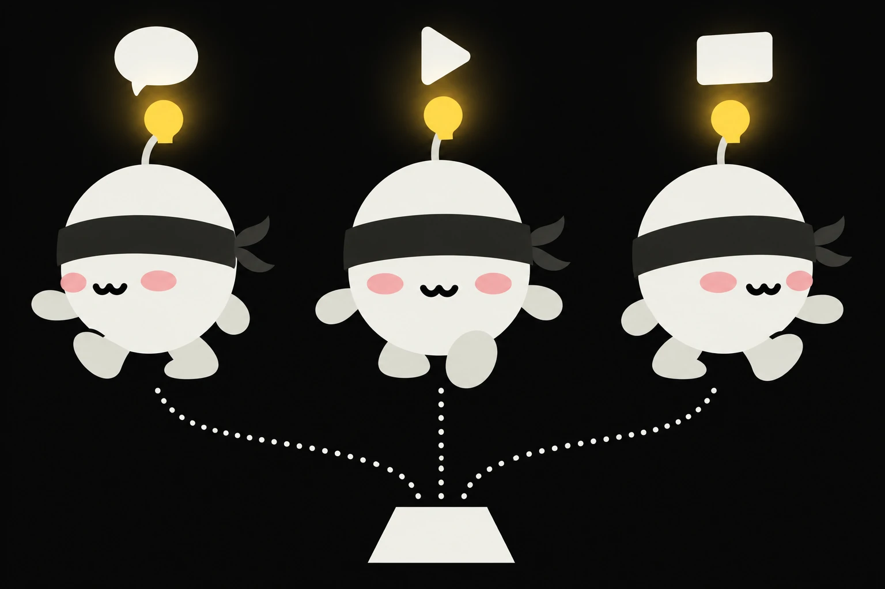
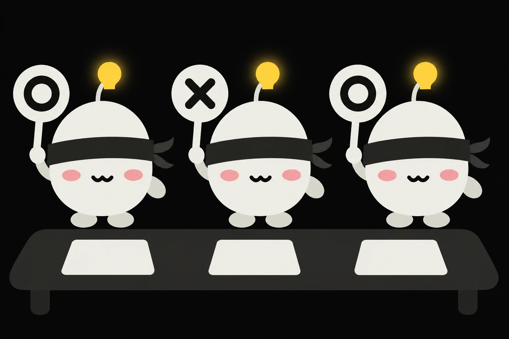
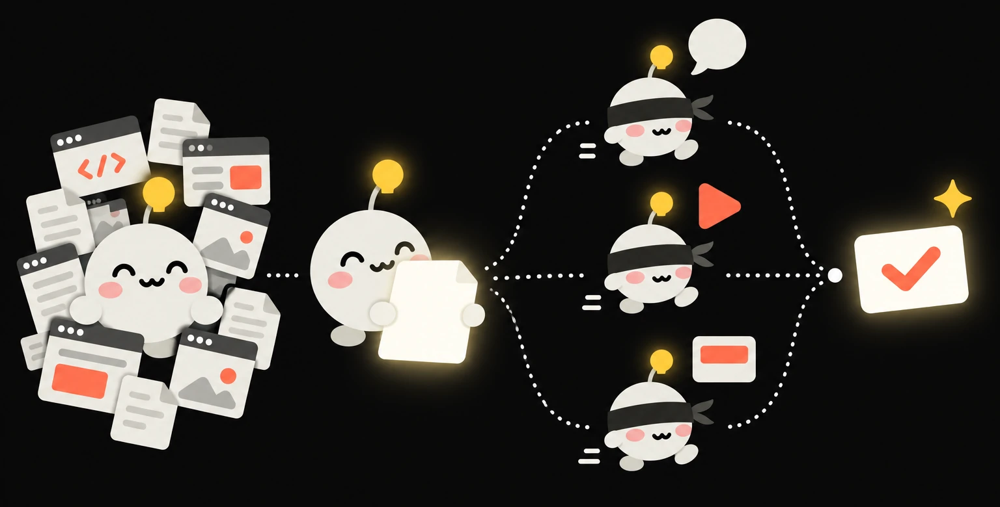

<div align="center">
  

  <h1>Blindfold</h1>

  <p><strong>知るほどに、発想は狭まる。</strong></p>
  <p>エージェントがすでに知っていることを隠し、<br>新しいサブエージェントにゼロから考えさせる Agent Skill。</p>

  <p>
    <a href="https://agentskills.io"></a>
    
    
    
    <a href="LICENSE"></a>
  </p>

  <p><a href="README.md">English</a> · <a href="README.ko.md">한국어</a> · <a href="README.zh-CN.md">简体中文</a> · <strong>日本語</strong> · <a href="README.es.md">Español</a></p>
</div>

---

## なぜ必要か

画面やコード、会話を読み込んだエージェントは、それを基準に考えてしまいます。新しい方向性を求めても既存のもののバリエーションを返し、主張の検証を頼めば同意する理由を探します。セッションが長くなるほど、この引力は強まります。

Blindfold はそのコンテキストをメインエージェントの手元に残し、1 枚のブリーフだけを持たせた独立したサブエージェントを送り出します。サブエージェントはファイルを読めないので、今の解決策を真似することもできません。

## クイックスタート

```bash
npx skills add jeonghyeon00/blindfold-skill
```

あとはエージェントで:

```text
/blindfold Rework onboarding to cut sign-up drop-off
```

「まったく違う方向性の案がほしい」「この主張をファクトチェックして」「どっちがいい?」のように普通に頼むだけでも動きます。Claude Code と Codex のプラグインは[インストール](#インストール)を参照してください。

## 3 つのモード

<table>
  <tr>
    <td width="33%" valign="top">
      
      <h3>Brainstorm</h3>
      <p>新しいアイデア、リデザイン、別の方向性がほしいとき。<br>デフォルトでは<strong>サブエージェント 3 体</strong>がそれぞれ代替案を 1 つずつ設計します。メインエージェントが比較し、あなたが選んだ案を既存のデザインシステムとコードに合わせて適用します。</p>
    </td>
    <td width="33%" valign="top">
      
      <h3>Research</h3>
      <p>ファクトチェック、調査、独立したセカンドオピニオンがほしいとき。<br>デフォルトでは<strong>サブエージェント 1 体</strong>が外部の情報源をもとに調べます。メインエージェントは結果を自分の見立てと突き合わせ、一致・部分的に一致・矛盾のいずれかで判定します。</p>
    </td>
    <td width="33%" valign="top">
      
      <h3>Decide</h3>
      <p>手元にある選択肢から選ぶとき。<br>デフォルトでは<strong>審査員 3 体</strong>。選択肢は Option 1, 2, 3 と呼び替え、どれが現行のものかは伏せ、審査員ごとに提示順を変えます。得票数、理由、そして何が変われば判断が変わるかが返ってきます。Brainstorm の代替案をそのまま Decide に渡すこともできます。</p>
    </td>
  </tr>
</table>

モードはリクエストに応じてエージェントが選びます。サブエージェントの数を指定すれば、その数だけ起動します。

## 仕組み

<p align="center"></p>

1. **抽出。** メインエージェントがリクエストを `BRIEF.md` にまとめます。中身は **Goal** と、それを達成するのに必要な **Context** だけです。サブエージェントはファイルを読めないため、プロダクトの説明やブランドカラーの値といった事実はブリーフに直接書きます。Brainstorm のブリーフには既存の解決策を、Research のブリーフには検証対象の主張とメインエージェントが予想する答えを書きません。Decide のブリーフでは、どれが現行かを示さずに選択肢を中立な番号で並べます。
2. **隔離。** サブエージェントはそれぞれ個別に起動され、1 行目に異なる `Random seed` とブリーフだけを受け取ります。Web 検索と Web フェッチ以外のツールは使いません。
3. **収集。** 各サブエージェントは、ほかの回答も既存の回答も見ないまま、代替案を設計するか根拠を集めます。
4. **比較。** すべてのコンテキストを持つメインエージェントが結果を比較し、あなたの選択に従って進めます。

## 例

```text
/blindfold Rework onboarding to cut sign-up drop-off
```

メインエージェントは次のようなブリーフを書きます。何が書かれていないかに注目してください。現在のオンボーディングが 3 ステップのフォームだということは、どこにも書かれていません。

```markdown
## Goal
登録途中の離脱を減らし、登録完了率を 55% 以上に引き上げる。

## Context
- デザイナー、開発者、PM が一緒に使う Web ホワイトボード。
- ユーザーから見た問題: 登録を始めた人の 10 人中 6 人が完了前に離脱する。特にモバイルでひどい。
- ユーザーは入力項目が多く見えるせいだと推測している。原因は確認されていない。
- 現在の登録完了率は 38%。
- ブランドカラー: メイン #3B5BFD、テキスト #111318。ロゴは左上のテキストワードマーク。
- 収集する情報はメールアドレス、パスワード、職種の 3 つだけ。
- 幅 360px の最初の画面内で完結すること。
```

3 体のサブエージェントが持ち帰るのは、フォームを少しずつ手直しした 3 案ではなく、まったく形の違う 3 案です。

| | 代替案 | アイデア |
| :- | :- | :- |
| **A** | 会話型の登録 | チャットのように 1 問ずつ尋ねる |
| **B** | まず試してもらう | 先にプロダクトを使ってもらい、最初に保存するときに登録を促す |
| **C** | 1 枚のカード | すべてを 1 枚のカードに収め、職種はワンタップのチップで選ぶ |

## インストール

### Claude Code

```text
/plugin marketplace add jeonghyeon00/blindfold-skill
/plugin install blindfold@blindfold
```

### Codex

```bash
codex plugin marketplace add jeonghyeon00/blindfold-skill
codex plugin add blindfold@blindfold
```

### Agent Skills に対応したすべてのエージェント

```bash
npx skills add jeonghyeon00/blindfold-skill
```

または `plugins/blindfold/skills/blindfold/` を `~/.claude/skills/`(Claude Code)か `~/.agents/skills/`(Codex など)にコピーしてください。

### 呼び出し方

| インストール方法 | 呼び出し |
| :- | :- |
| Claude Code プラグイン | `/blindfold:blindfold <リクエスト>` |
| Claude Code スキル(`npx skills`、コピー) | `/blindfold <リクエスト>` |
| Codex | `$blindfold <リクエスト>` |

## 原則

- **ブリーフが唯一の経路。** `BRIEF.md` に書かれていないものは、サブエージェントにとって存在しません。だからブリーフには「ブランドカラーを維持」ではなく実際の値を書きます。
- **同じブリーフ、誘導なし。** すべてのサブエージェントは同じブリーフだけを受け取ります。方向性もペルソナもヒントも与えません。多様性はメインエージェントからではなく、隔離と seed から生まれます。
- **メインエージェントは比較するだけで、設計はしない。** すでに既存の解決策を見てしまっているからです。サブエージェントを起動できない場合、Blindfold はそれらしく装わずに停止します。
- **審査員には現状を一切知らせない。** Decide モードでは、選択肢に名前はなく、どれが現行かのヒントもなく、審査員ごとに提示順も異なります。
- **食い違いこそがシグナル。** Research モードでは、メインエージェントの見立てと矛盾するというだけで結果を退けず、情報源を確認します。

## 構成

```text
.claude-plugin/marketplace.json     Claude Code マーケットプレイス
.agents/plugins/marketplace.json    Codex マーケットプレイス
plugins/blindfold/
├─ .claude-plugin/plugin.json       Claude Code プラグインマニフェスト
├─ .codex-plugin/plugin.json        Codex プラグインマニフェスト
├─ assets/                          プラグインアイコン
└─ skills/blindfold/                Agent Skills 形式のスキル本体
   ├─ SKILL.md
   ├─ references/brief.md           ブリーフのテンプレート、チェックリスト、モード別の例
   ├─ references/prompt-brainstorm.md
   ├─ references/prompt-research.md
   ├─ references/prompt-decide.md
   └─ agents/openai.yaml            Codex UI メタデータ
scripts/validate.mjs                静的チェック
docs/images/                        README の画像
site/                               紹介サイト
```

## 開発

```bash
node scripts/validate.mjs                      # 仕様ルール、マニフェスト・バージョン・パスの整合性
uvx --from 'git+https://github.com/agentskills/agentskills#subdirectory=skills-ref' \
  skills-ref validate plugins/blindfold/skills/blindfold
claude plugin validate . && claude plugin validate ./plugins/blindfold
```

リリース時は、2 つの `plugin.json`、`.claude-plugin/marketplace.json`、`SKILL.md` の `metadata.version` のバージョンをすべて上げてください。1 つでも食い違うと `validate.mjs` が失敗し、同じチェックが GitHub Actions でも実行されます。

## ライセンス

[MIT](LICENSE)
