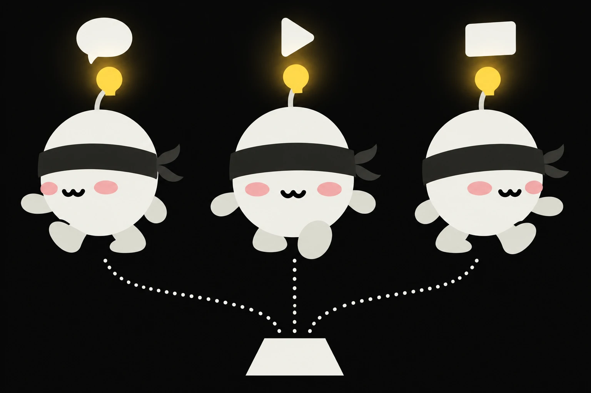
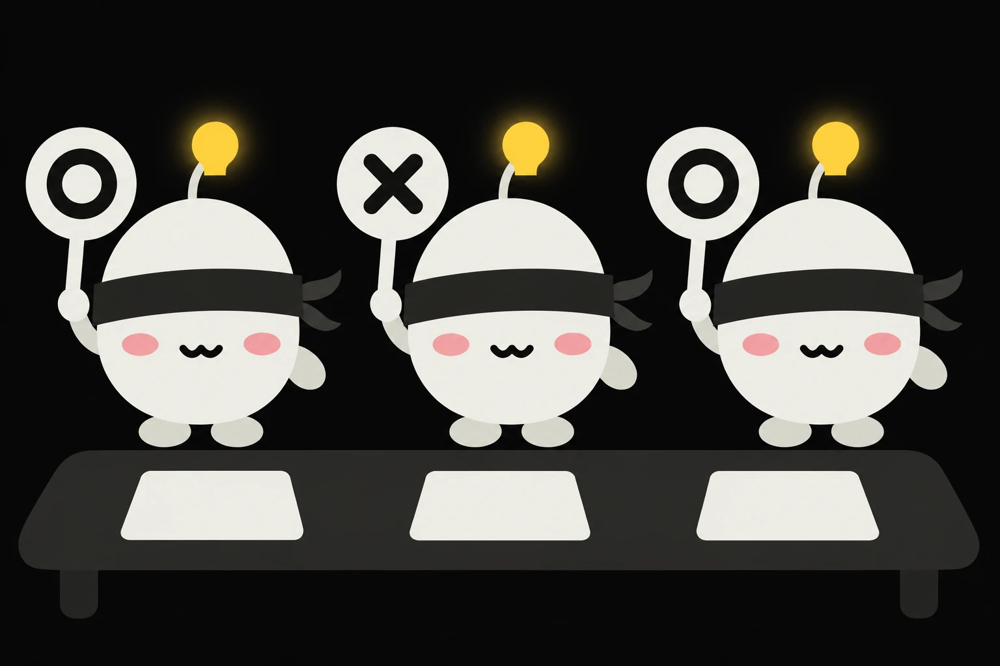
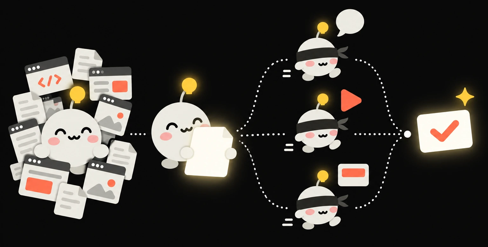

<div align="center">
  

  <h1>Blindfold</h1>

  <p><strong>많이 알수록, 덜 떠올린다.</strong></p>
  <p>에이전트가 이미 아는 것을 가리고,<br>새 서브에이전트가 처음부터 생각하게 하는 Agent Skill.</p>

  <p>
    <a href="https://agentskills.io"></a>
    
    
    
    <a href="LICENSE"></a>
  </p>

  <p><a href="README.md">English</a> · <strong>한국어</strong> · <a href="README.zh-CN.md">简体中文</a> · <a href="README.ja.md">日本語</a> · <a href="README.es.md">Español</a></p>
</div>

---

## 왜 필요한가

에이전트는 이미 본 화면과 코드, 대화를 기준점으로 삼습니다. 새 방향을 물어도 있는 것의 변형을 내놓고, 주장을 확인해 달라고 하면 맞다는 근거부터 찾습니다. 세션이 길어질수록 이 끌림은 강해집니다.

Blindfold는 그 컨텍스트를 메인 에이전트에게만 두고, 브리프 한 장만 든 독립된 서브에이전트를 내보냅니다. 서브에이전트는 파일을 읽을 수 없으니 지금의 해결책을 따라 할 수도 없습니다.

## 빠른 시작

```bash
npx skills add jeonghyeon00/blindfold-skill
```

그리고 에이전트에서:

```text
/blindfold 온보딩 이탈 방지를 위해 온보딩을 다시 구성하고 싶어
```

"완전히 다른 방향의 시안이 필요해", "이 주장 맞는지 팩트체크해 줘", "이 중에 뭐가 나아?"처럼 말해도 됩니다. Claude Code와 Codex 플러그인은 [설치](#설치)를 보세요.

## 세 가지 모드

<table>
  <tr>
    <td width="33%" valign="top">
      
      <h3>Brainstorm</h3>
      <p>새 아이디어, 리디자인, 다른 방향이 필요할 때.<br>기본 <strong>서브에이전트 3개</strong>가 대안을 하나씩 설계합니다. 메인 에이전트가 비교하고, 사용자가 고르면 기존 디자인 시스템과 코드에 맞춰 적용합니다.</p>
    </td>
    <td width="33%" valign="top">
      
      <h3>Research</h3>
      <p>팩트체크, 조사, 독립적인 두 번째 의견이 필요할 때.<br>기본 <strong>서브에이전트 1개</strong>가 외부 자료로 조사합니다. 메인 에이전트는 결과를 기존 판단과 대조해 일치, 부분 일치, 충돌로 판정합니다.</p>
    </td>
    <td width="33%" valign="top">
      
      <h3>Decide</h3>
      <p>이미 있는 선택지 중에 고를 때.<br>기본 <strong>심사 3명</strong>. 선택지는 Option 1, 2, 3으로만 부르고, 지금 쓰는 게 무엇인지 알리지 않으며, 심사마다 순서를 섞습니다. 득표, 이유, 무엇이 바뀌면 판단이 달라지는지를 받습니다. Brainstorm 결과를 바로 Decide로 넘길 수도 있습니다.</p>
    </td>
  </tr>
</table>

요청에 맞춰 모드를 고르고, 개수를 말하면 그만큼 띄웁니다.

## 작동 방식

<p align="center"></p>

1. **추출.** 메인 에이전트가 요청을 `BRIEF.md` 한 장으로 줄입니다. **Goal**, 그리고 그 Goal에 필요한 **Context**만 담습니다. 서브에이전트는 파일을 읽을 수 없으므로 서비스 설명, 브랜드 컬러 값 같은 핵심 정보는 브리프에 직접 적습니다. Brainstorm에서는 기존 해결책을, Research에서는 확인하려는 주장과 메인 에이전트가 예상하는 답을, Decide에서는 어느 선택지가 지금 쓰는 것인지를 적지 않고 번호로만 나열합니다.
2. **격리.** 서브에이전트를 따로 띄웁니다. 각자 첫 줄에 다른 `Random seed`와 브리프만 받고, 웹 검색과 웹 페치 외의 도구는 쓰지 않습니다.
3. **수집.** 각자 서로의 답도, 기존 답도 모른 채 대안을 설계하거나 근거를 찾아옵니다.
4. **비교.** 전체 컨텍스트를 가진 메인 에이전트가 결과를 비교하고, 사용자의 선택대로 진행합니다.

## 예시

```text
/blindfold 온보딩 이탈 방지를 위해 온보딩을 다시 구성하고 싶어
```

메인 에이전트는 이런 브리프를 씁니다. 지금 온보딩이 3단계 폼이라는 사실은 어디에도 없습니다.

```markdown
## Goal
가입 도중 이탈을 줄여 가입 완료율을 55% 이상으로 올린다.

## Context
- 디자이너·개발자·기획자가 함께 쓰는 웹 협업 화이트보드.
- 사용자가 보는 문제: 가입을 시작한 사람 열에 여섯이 끝내지 않고 떠난다. 모바일에서 특히 심하다.
- 사용자는 입력할 것이 많아 보여서라고 추정한다. 확인된 원인은 아니다.
- 지금 가입 완료율은 38%다.
- 브랜드 컬러는 주색 #3B5BFD, 글자 #111318. 로고는 좌측 상단 텍스트 워드마크.
- 받는 정보는 이메일, 비밀번호, 직군 세 가지.
- 360px 폭의 첫 화면 안에서 끝나야 한다.
```

서브에이전트 셋은 폼을 조금씩 고친 세 안이 아니라, 서로 다른 세 갈래를 가져옵니다.

| | 대안 | 아이디어 |
| :- | :- | :- |
| **A** | 대화형 온보딩 | 채팅처럼 한 번에 하나씩 묻기 |
| **B** | 먼저 써 보기 | 가입 없이 바로 써 보고, 처음 저장할 때 가입 |
| **C** | 한 장짜리 카드 | 카드 한 장에 모두 담고, 직군은 한 번에 고르는 칩으로 |

## 설치

### Claude Code

```text
/plugin marketplace add jeonghyeon00/blindfold-skill
/plugin install blindfold@blindfold
```

### Codex

```bash
codex plugin marketplace add jeonghyeon00/blindfold-skill
codex plugin add blindfold@blindfold
```

### Agent Skills를 지원하는 모든 에이전트

```bash
npx skills add jeonghyeon00/blindfold-skill
```

직접 복사해도 됩니다. `plugins/blindfold/skills/blindfold/` 폴더를 `~/.claude/skills/`(Claude Code)나 `~/.agents/skills/`(Codex 등)에 넣으면 됩니다.

### 호출

| 설치 방식 | 호출 |
| :- | :- |
| Claude Code 플러그인 | `/blindfold:blindfold <요청>` |
| Claude Code 스킬 (`npx skills`, 복사) | `/blindfold <요청>` |
| Codex | `$blindfold <요청>` |

## 원칙

- **브리프가 유일한 통로입니다.** `BRIEF.md`에 없는 것은 서브에이전트에게 존재하지 않습니다. 그래서 "브랜드 컬러 유지" 대신 실제 값을 적습니다.
- **같은 브리프, 조종 없음.** 모든 서브에이전트가 같은 브리프만 받습니다. 방향, 페르소나, 힌트를 주지 않습니다. 다양성은 메인 에이전트가 아니라 격리와 seed에서 나옵니다.
- **메인 에이전트는 비교만 하고 설계하지 않습니다.** 이미 기존 해결책을 봤기 때문입니다. 서브에이전트를 띄울 수 없으면 흉내 내지 않고 멈춥니다.
- **심사에게 지금 것을 알리지 않습니다.** Decide에서는 선택지 이름도, 어느 것이 지금 쓰는 것인지도 없고, 심사마다 순서가 다릅니다.
- **어긋남이 신호입니다.** Research에서는 결과가 기존 판단과 다르다는 이유만으로 버리지 않고, 출처를 직접 확인합니다.

## 구성

```text
.claude-plugin/marketplace.json     Claude Code 마켓플레이스
.agents/plugins/marketplace.json    Codex 마켓플레이스
plugins/blindfold/
├─ .claude-plugin/plugin.json       Claude Code 플러그인 매니페스트
├─ .codex-plugin/plugin.json        Codex 플러그인 매니페스트
├─ agents/blind-subagent.md         Claude Code 서브에이전트 (웹 검색과 웹 페치만 사용)
├─ assets/                          플러그인 아이콘
└─ skills/blindfold/                Agent Skills 표준 스킬
   ├─ SKILL.md
   ├─ references/brief.md           브리프 템플릿, 체크리스트, 모드별 예시
   ├─ references/prompt-brainstorm.md
   ├─ references/prompt-research.md
   ├─ references/prompt-decide.md
   └─ agents/openai.yaml            Codex UI 메타데이터
scripts/validate.mjs                정적 검증
docs/images/                        README 그림
site/                               홍보 사이트
```

## 개발

```bash
node scripts/validate.mjs                      # 스펙, 매니페스트, 버전·경로 일치
uvx --from 'git+https://github.com/agentskills/agentskills#subdirectory=skills-ref' \
  skills-ref validate plugins/blindfold/skills/blindfold
claude plugin validate . && claude plugin validate ./plugins/blindfold
```

배포할 때는 두 `plugin.json`, `.claude-plugin/marketplace.json`, `SKILL.md`의 `metadata.version`을 함께 올립니다. 하나라도 어긋나면 `validate.mjs`가 실패하고, 같은 검사가 GitHub Actions에서도 돌아갑니다.

## 라이선스

[MIT](LICENSE)
