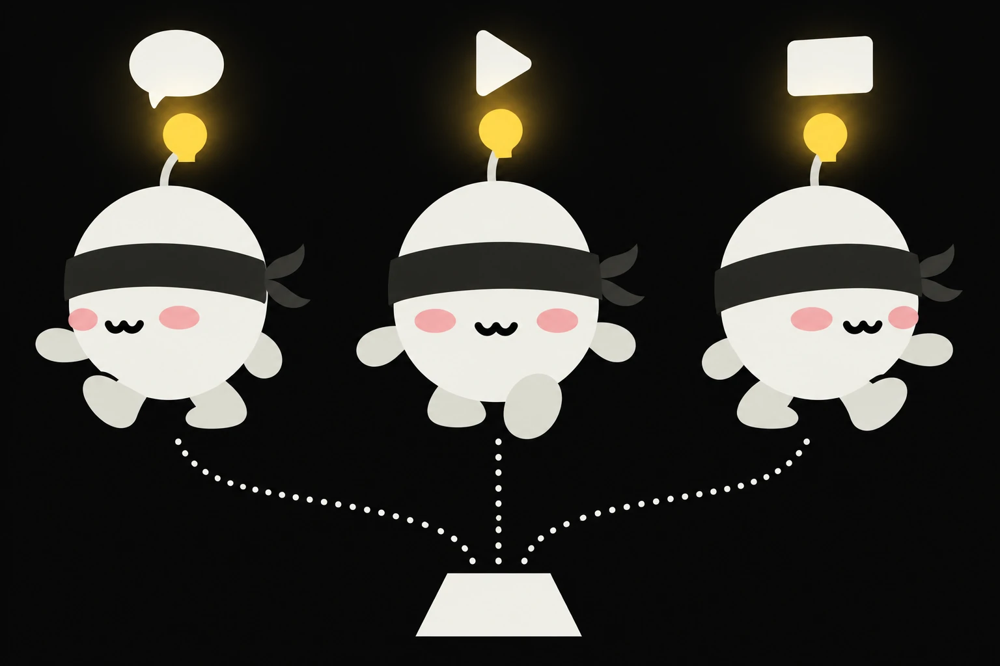
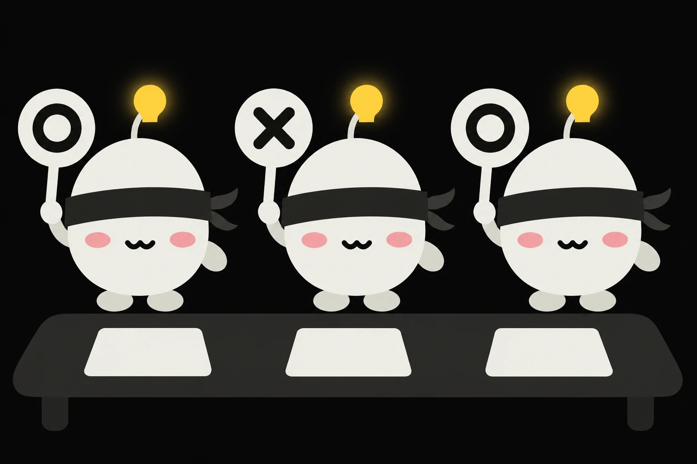
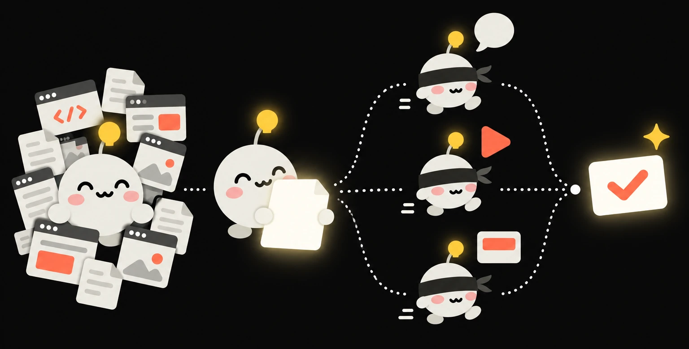

<div align="center">
  

  <h1>Blindfold</h1>

  <p><strong>The more it knows, the less it imagines.</strong></p>
  <p>An Agent Skill that hides what your agent already knows,<br>so fresh subagents can think from scratch.</p>
  <p><a href="https://blindfold.cmdrun.net/"><strong>Visit the Blindfold website</strong></a></p>

  <p>
    <a href="https://agentskills.io"></a>
    
    
    
    <a href="LICENSE"></a>
  </p>

  <p><strong>English</strong> · <a href="README.ko.md">한국어</a> · <a href="README.zh-CN.md">简体中文</a> · <a href="README.ja.md">日本語</a> · <a href="README.es.md">Español</a></p>
</div>

---

## Why

An agent that has read your screens, code and conversation anchors on them. Ask it for a new direction and it hands back a variation of what already exists; ask it to check a claim and it finds reasons to agree. The longer the session, the stronger the pull.

Blindfold keeps that context with the main agent and sends independent subagents out with nothing but a one-page brief. They cannot read your files, so they cannot copy your current solution.

## Quick start

```bash
npx skills add jeonghyeon00/blindfold-skill
```

Then, in your agent:

```text
/blindfold Rework onboarding to cut sign-up drop-off
```

Or just ask in plain words: "I need a completely different direction for this", "fact-check this claim", "which of these is better?". See [Install](#install) for the Claude Code and Codex plugins.

## Three modes

<table>
  <tr>
    <td width="33%" valign="top">
      
      <h3>Brainstorm</h3>
      <p>New ideas, a redesign, other directions.<br><strong>3 subagents</strong> by default, each designing one alternative. The main agent compares them, you pick, and it applies your pick to the existing design system and code.</p>
    </td>
    <td width="33%" valign="top">
      
      <h3>Research</h3>
      <p>Fact-checks, research, an independent second opinion.<br><strong>1 subagent</strong> by default, working from outside sources. The main agent holds the finding against what it believed: agrees, partly agrees, or conflicts.</p>
    </td>
    <td width="33%" valign="top">
      
      <h3>Decide</h3>
      <p>Choosing between options you already have.<br><strong>3 judges</strong> by default. Options are renamed Option 1, 2, 3, nothing says which one exists today, and each judge sees them in a different order. You get the tally, the reasons, and what would change their minds. Brainstorm can hand its alternatives straight to Decide.</p>
    </td>
  </tr>
</table>

The agent picks the mode from your request. Ask for a number of subagents and it uses that many.

## How it works

<p align="center"></p>

1. **Extract.** The main agent condenses the request into `BRIEF.md`: a **Goal**, and only the **Context** needed to reach it. Subagents cannot read files, so facts like what the product is or the brand colour values are written into the brief. Brainstorm briefs leave out the existing solution; Research briefs leave out the claim being checked and the answer the main agent expects; Decide briefs list the options under neutral numbers, without saying which one exists today.
2. **Isolate.** Each subagent is spawned on its own with a different `Random seed` on the first line and the brief, and uses no tools except web search and web fetch.
3. **Collect.** Each one designs an alternative or gathers evidence without seeing the others' answers or the existing one.
4. **Compare.** The main agent, which still has the full context, compares the results and acts on your choice.

## Example

```text
/blindfold Rework onboarding to cut sign-up drop-off
```

The main agent writes a brief like this. Note what is missing: nothing says the current onboarding is a three-step form.

```markdown
## Goal
Cut drop-off during sign-up and raise sign-up completion to 55% or more.

## Context
- A web whiteboard that designers, developers and PMs use together.
- The problem as the user sees it: six in ten people who start signing up leave before finishing, worst on mobile.
- The user guesses it is because there looks like a lot to fill in. The cause is not confirmed.
- Sign-up completion is 38% today.
- Brand colours: primary #3B5BFD, text #111318. Logo: a text wordmark, top left.
- Collect exactly three things: email, password, role.
- It must finish within the first screen at 360px wide.
```

Three subagents come back with three different shapes instead of three tweaks of the form:

| | Alternative | Idea |
| :- | :- | :- |
| **A** | Conversational sign-up | Ask one question at a time, like a chat |
| **B** | Try first | Let people use the product, ask them to sign up when they first save |
| **C** | One card | Everything on a single card, with role as one-tap chips |

## Install

### Claude Code

```text
/plugin marketplace add jeonghyeon00/blindfold-skill
/plugin install blindfold@blindfold
```

### Codex

```bash
codex plugin marketplace add jeonghyeon00/blindfold-skill
codex plugin add blindfold@blindfold
```

### Any agent that supports Agent Skills

```bash
npx skills add jeonghyeon00/blindfold-skill
```

Or copy `plugins/blindfold/skills/blindfold/` into `~/.claude/skills/` (Claude Code) or `~/.agents/skills/` (Codex and others).

### Invoking it

| Installed as | Invoke with |
| :- | :- |
| Claude Code plugin | `/blindfold:blindfold <request>` |
| Claude Code skill (`npx skills`, copied) | `/blindfold <request>` |
| Codex | `$blindfold <request>` |

## Principles

- **The brief is the only channel.** Whatever is not in `BRIEF.md` does not exist for the subagents, so the brief carries real values, never "keep the brand colours".
- **Same brief, no steering.** Every subagent gets the same brief and nothing else: no assigned directions, personas or hints. Variety comes from isolation and the seed, not from the main agent.
- **The main agent compares; it never designs.** It has already seen the existing solution. If it cannot spawn subagents, Blindfold stops instead of faking it.
- **Nothing tells a judge what is already there.** In Decide mode the options carry no names, no hint of which one is current, and a different order for each judge.
- **Disagreement is the signal.** In Research mode a finding is not dismissed just because it contradicts what the main agent believed; the sources get checked.

## What's inside

```text
.claude-plugin/marketplace.json     Claude Code marketplace
.agents/plugins/marketplace.json    Codex marketplace
plugins/blindfold/
├─ .claude-plugin/plugin.json       Claude Code plugin manifest
├─ .codex-plugin/plugin.json        Codex plugin manifest
├─ assets/                          Plugin icons
└─ skills/blindfold/                The skill, in the Agent Skills format
   ├─ SKILL.md
   ├─ references/brief.md           Brief templates, checklist, an example per mode
   ├─ references/prompt-brainstorm.md
   ├─ references/prompt-research.md
   ├─ references/prompt-decide.md
   └─ agents/openai.yaml            Codex UI metadata
scripts/validate.mjs                Static checks
docs/images/                        README art
site/                               Promo site
```

## Development

```bash
node scripts/validate.mjs                      # spec rules; manifests, versions and paths agree
uvx --from 'git+https://github.com/agentskills/agentskills#subdirectory=skills-ref' \
  skills-ref validate plugins/blindfold/skills/blindfold
claude plugin validate . && claude plugin validate ./plugins/blindfold
```

To release, bump the version in both `plugin.json` files, `.claude-plugin/marketplace.json`, and `metadata.version` in `SKILL.md`. `validate.mjs` fails if any of them disagree, and the same checks run in GitHub Actions.

## License

[MIT](LICENSE)
