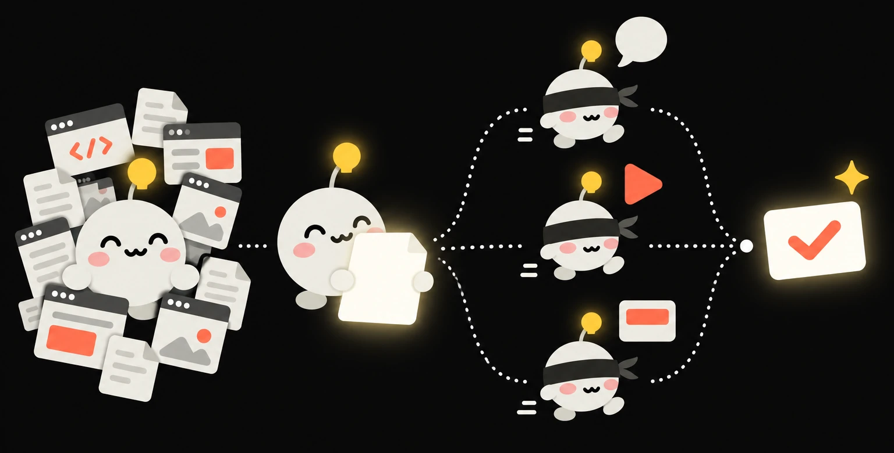

<div align="center">
  

  <h1>Blindfold</h1>

  <p><strong>知道得越多，想象得越少。</strong></p>
  <p>一个 Agent Skill：遮住 agent 已经知道的东西，<br>让全新的 subagent 从零开始思考。</p>

  <p>
    <a href="https://agentskills.io"></a>
    
    
    
    <a href="LICENSE"></a>
  </p>

  <p><a href="README.md">English</a> · <a href="README.ko.md">한국어</a> · <strong>简体中文</strong> · <a href="README.ja.md">日本語</a> · <a href="README.es.md">Español</a></p>
</div>

---

## 为什么需要它

agent 读过你的界面、代码和对话之后，就会以它们为锚点。让它给出新方向，它交回的是现有方案的变体；让它核实一个说法，它会先找理由附和。会话越长，这种牵引越强。

Blindfold 把这些上下文只留在主 agent 手里，派出彼此独立的 subagent，它们只带一页 brief。subagent 读不到你的文件，自然也无从照抄你现在的方案。

## 快速开始

```bash
npx skills add jeonghyeon00/blindfold-skill
```

然后在 agent 中输入：

```text
/blindfold 重新设计注册引导流程，降低注册流失
```

也可以直接用自然语言说："我需要一个完全不同的方向"、"帮我核实一下这个说法"、"这几个哪个更好？"。Claude Code 和 Codex 插件见[安装](#安装)。

## 三种模式

<table>
  <tr>
    <td width="33%" valign="top">
      
      <h3>Brainstorm</h3>
      <p>需要新点子、重新设计或其他方向时。<br>默认 <strong>3 个 subagent</strong>，各自设计一个备选方案。主 agent 进行比较，你来挑选，再由它按现有设计系统和代码落地你选中的方案。</p>
    </td>
    <td width="33%" valign="top">
      
      <h3>Research</h3>
      <p>需要事实核查、调研或独立的第二意见时。<br>默认 <strong>1 个 subagent</strong>，基于外部来源调研。主 agent 把结论与自己原先的判断对照：一致、部分一致或冲突。</p>
    </td>
    <td width="33%" valign="top">
      
      <h3>Decide</h3>
      <p>在已有的选项中做选择时。<br>默认 <strong>3 位评审</strong>。选项统一改称 Option 1、2、3，不透露哪个是现行方案，每位评审看到的顺序也不同。你会拿到票数、理由，以及什么情况下他们会改变判断。Brainstorm 的备选方案可以直接交给 Decide。</p>
    </td>
  </tr>
</table>

agent 会根据你的请求选择模式。指定 subagent 数量，它就照数量派出。

## 工作原理

<p align="center"></p>

1. **提炼。** 主 agent 把请求浓缩成 `BRIEF.md`：一个 **Goal**，以及实现它所需的 **Context**，仅此而已。subagent 读不到文件，所以产品是什么、品牌色的具体数值这类事实都要直接写进 brief。Brainstorm 的 brief 不写现有方案；Research 的 brief 不写待核实的说法和主 agent 预期的答案；Decide 的 brief 只用中性编号列出选项，不说明哪个是现行方案。
2. **隔离。** 每个 subagent 单独启动，第一行是各不相同的 `Random seed`，后面是 brief；除网页搜索和网页抓取外不使用任何工具。
3. **收集。** 每个 subagent 在看不到其他人答案、也看不到现有方案的情况下，设计备选方案或搜集证据。
4. **比较。** 仍掌握完整上下文的主 agent 比较结果，并按你的选择推进。

## 示例

```text
/blindfold 重新设计注册引导流程，降低注册流失
```

主 agent 会写出这样的 brief。注意缺了什么：没有任何地方提到现在的引导流程是一个三步表单。

```markdown
## Goal
减少注册过程中的流失，把注册完成率提升到 55% 以上。

## Context
- 一款供设计师、开发者和产品经理协作使用的网页白板。
- 用户眼中的问题：开始注册的人里，十个有六个没完成就离开了，移动端尤其严重。
- 用户猜测是因为看起来要填的东西太多。原因尚未确认。
- 目前注册完成率为 38%。
- 品牌色：主色 #3B5BFD，文字 #111318。Logo：左上角的文字标识。
- 只收集三项：邮箱、密码、角色。
- 必须在 360px 宽的首屏内完成。
```

三个 subagent 带回的不是对表单的三处微调，而是三种截然不同的形态：

| | 备选方案 | 思路 |
| :- | :- | :- |
| **A** | 对话式注册 | 像聊天一样，一次只问一个问题 |
| **B** | 先用再注册 | 先让用户直接使用产品，首次保存时再请其注册 |
| **C** | 单张卡片 | 所有内容放在一张卡片上，角色用一键选择的标签 |

## 安装

### Claude Code

```text
/plugin marketplace add jeonghyeon00/blindfold-skill
/plugin install blindfold@blindfold
```

### Codex

```bash
codex plugin marketplace add jeonghyeon00/blindfold-skill
codex plugin add blindfold@blindfold
```

### 任何支持 Agent Skills 的 agent

```bash
npx skills add jeonghyeon00/blindfold-skill
```

也可以把 `plugins/blindfold/skills/blindfold/` 复制到 `~/.claude/skills/`（Claude Code）或 `~/.agents/skills/`（Codex 等）。

### 调用方式

| 安装方式 | 调用命令 |
| :- | :- |
| Claude Code 插件 | `/blindfold:blindfold <请求>` |
| Claude Code skill（`npx skills`、手动复制） | `/blindfold <请求>` |
| Codex | `$blindfold <请求>` |

## 原则

- **brief 是唯一的通道。** 不在 `BRIEF.md` 里的内容，对 subagent 来说就不存在，所以 brief 里写的是真实数值，而不是"保持品牌色"。
- **同一份 brief，不加引导。** 每个 subagent 拿到的都是同一份 brief，别无其他：不分配方向、不设人设、不给提示。多样性来自隔离和 seed，而不是主 agent。
- **主 agent 只比较，不设计。** 它已经看过现有方案。如果无法启动 subagent，Blindfold 会直接停止，而不是假装完成。
- **不告诉评审现状是什么。** 在 Decide 模式下，选项没有名称，不暗示哪个是现行方案，每位评审看到的顺序也不同。
- **分歧就是信号。** 在 Research 模式下，不会因为结论与主 agent 原先的判断相悖就将其否定，而是去核查来源。

## 目录结构

```text
.claude-plugin/marketplace.json     Claude Code marketplace
.agents/plugins/marketplace.json    Codex marketplace
plugins/blindfold/
├─ .claude-plugin/plugin.json       Claude Code 插件清单
├─ .codex-plugin/plugin.json        Codex 插件清单
├─ assets/                          插件图标
└─ skills/blindfold/                Agent Skills 格式的 skill
   ├─ SKILL.md
   ├─ references/brief.md           brief 模板、检查清单、各模式示例
   ├─ references/prompt-brainstorm.md
   ├─ references/prompt-research.md
   ├─ references/prompt-decide.md
   └─ agents/openai.yaml            Codex UI 元数据
scripts/validate.mjs                静态检查
docs/images/                        README 配图
site/                               宣传网站
```

## 开发

```bash
node scripts/validate.mjs                      # 规范检查；清单、版本与路径一致
uvx --from 'git+https://github.com/agentskills/agentskills#subdirectory=skills-ref' \
  skills-ref validate plugins/blindfold/skills/blindfold
claude plugin validate . && claude plugin validate ./plugins/blindfold
```

发布时，需同时更新两个 `plugin.json`、`.claude-plugin/marketplace.json` 以及 `SKILL.md` 中 `metadata.version` 的版本号。任何一处不一致，`validate.mjs` 都会失败，GitHub Actions 中也会运行同样的检查。

## 许可证

[MIT](LICENSE)
